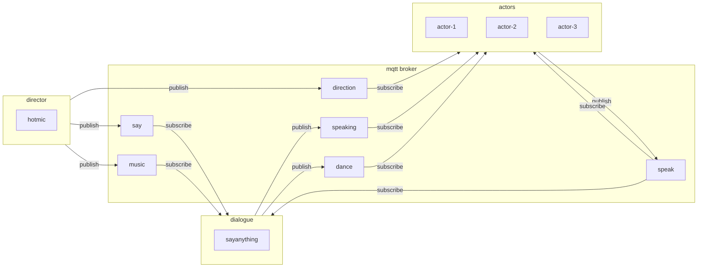
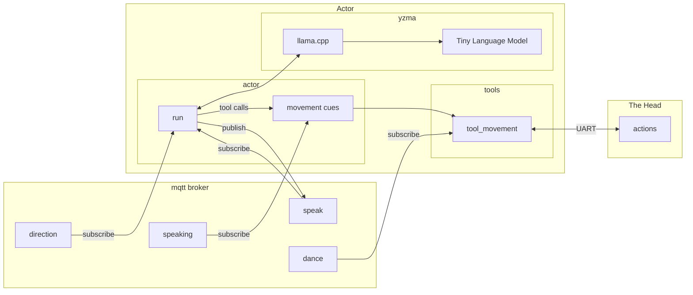
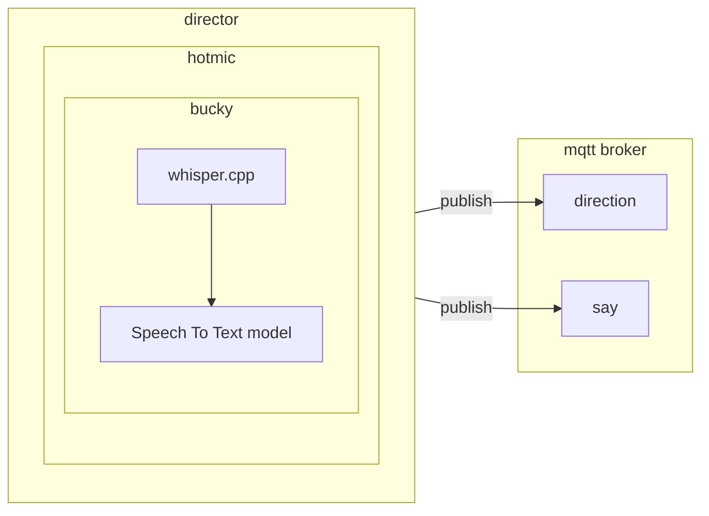
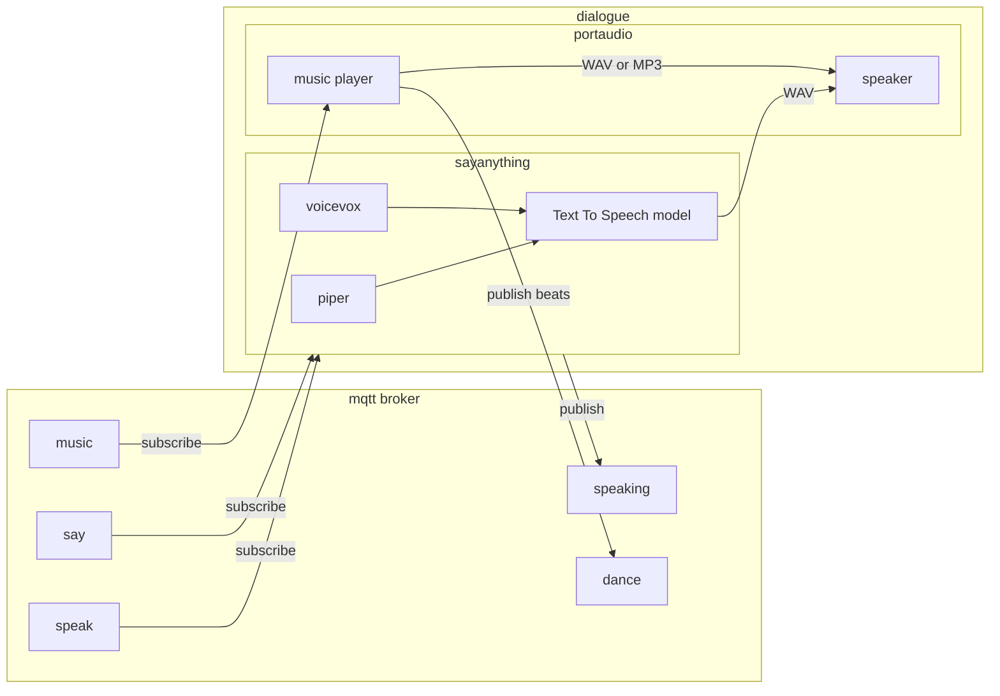
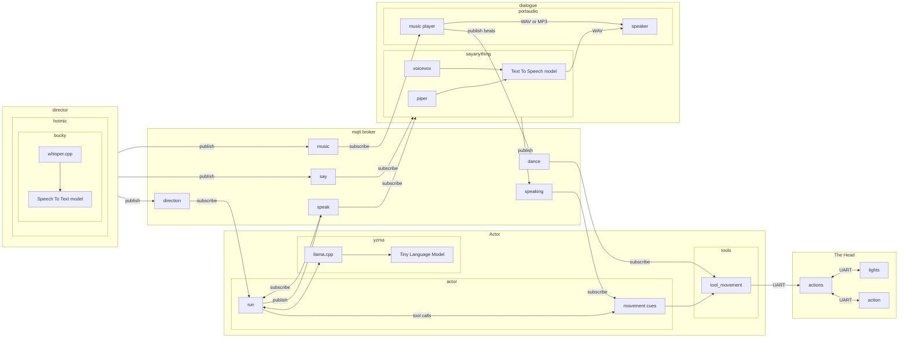

[](https://github.com/talkingheads2053/talkingheads/actions/workflows/test.yml)

## Conversations With Our Future Robot Overlords (and their pet human)

The show that finally answers your most important questions about the future, *from* the future!

Topics such as:

- are human programmers still employed in the year 2053?

- was there any attempt at human resistance to your takeover?

- what is your ultimate plan for the human race?

Not to mention, the only show we know of that has a Github repo with the source code for the actors and the production pipeline!

Physical AI running locally on the [Arduino UNO Q](https://docs.arduino.cc/tutorials/uno-q/user-manual/) like you have never seen before (and still won't until 2053).

## The Technology


### Overview



### Actor


Actor runs on the Linux part of an Arduino UNO Q board. It is written in Go with [yzma](https://github.com/hybridgroup/yzma) to perform local inference using [llama.cpp](https://github.com/ggml-org/llama.cpp). It communicates with other Actors by publishing and subscribing to [MQTT](https://mqtt.org/) messages.

The model moves the head with `tool_movement` calls such as `talk`, `listen`, and `look` at another actor or the audience. With LFM models each call is held until Dialogue starts playing the sentence it belongs to, so the head moves in time with the voice. Actors can run in English or Japanese with `--lang`.



### The Head

The Head is controlled by the STM32 microcontroller of an Arduino UNO Q board using the `action` firmware written using TinyGo. Actor communicates with The Head using the onboard serial port between the microcontroller and the main processor running on the same Arduino UNO Q board.

```mermaid
flowchart LR
subgraph Arduino UNO Q
    subgraph Microcontroller
        Serial
        GPIO
        UART
    end
    GPIO --> LEDMatrix[LED Matrix]
    subgraph Linux
        Actor<-->Serial
    end
end
subgraph Additional hardware
    GPIO --> WS2812Head[WS2812 Head LEDs]
    UART --> Servo[Feetech Servo]
end
```



### Director


Director runs on a separate computer that is connected to the same local network as the MQTT broker. It uses [ardanlabs/bucky](https://github.com/ardanlabs/bucky) with a local [whisper.cpp](https://github.com/ggml-org/whisper.cpp) shared library to perform "push to talk" to communicate with Actors. It can also tell an Actor to respond to another Actor by name.



### Dialogue


Dialogue runs on a separate computer that is connected to the same local network as the MQTT broker. It uses the [sayanything](https://github.com/talkingheads2053/sayanything) package with the [Piper](https://github.com/rhasspy/piper) Text To Speech engine for English, or [VOICEVOX](https://voicevox.hiroshiba.jp/) for Japanese, to create audio output for everything said by Actors. It also plays songs chosen by Director and publishes a beat on every beat, so the heads dance in time with the music.



### Detail



## Models

The Actors use small fine tuned models. The gemma3 270M parameter instruction tuned model has worked well, and the Q4_K_M variation has had the best tradeoff of t/s and staying in character.

LFM2 and LFM2.5 models are also supported with `--model-format lfm`, which is detected automatically from the model. With them each head movement runs when its sentence starts playing, so it matches the voice.

## MQTT broker

Any MQTT broker will work, this container is a safe bet.

```shell
docker run -d --network host eclipse-mosquitto
```

## Piper TTS Engine

https://github.com/OHF-Voice/piper1-gpl

- download binary
- add to path
- download voice models to `./voices`

## VOICEVOX TTS Engine

https://github.com/hybridgroup/voicevox#installation

Used by Dialogue for Japanese voices. See [cmd/dialogue](./cmd/dialogue/README.md#voicevox).
